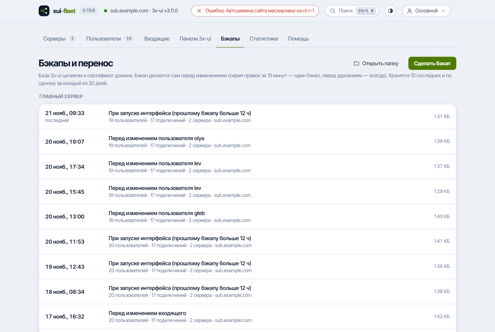
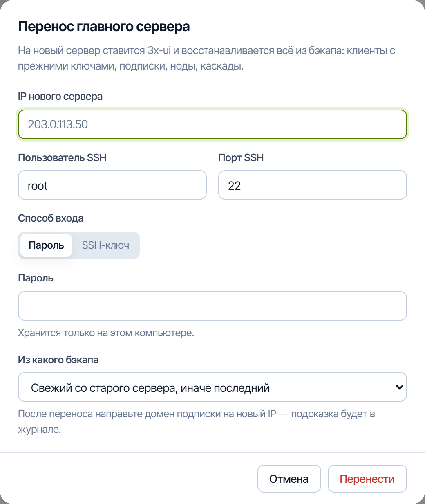
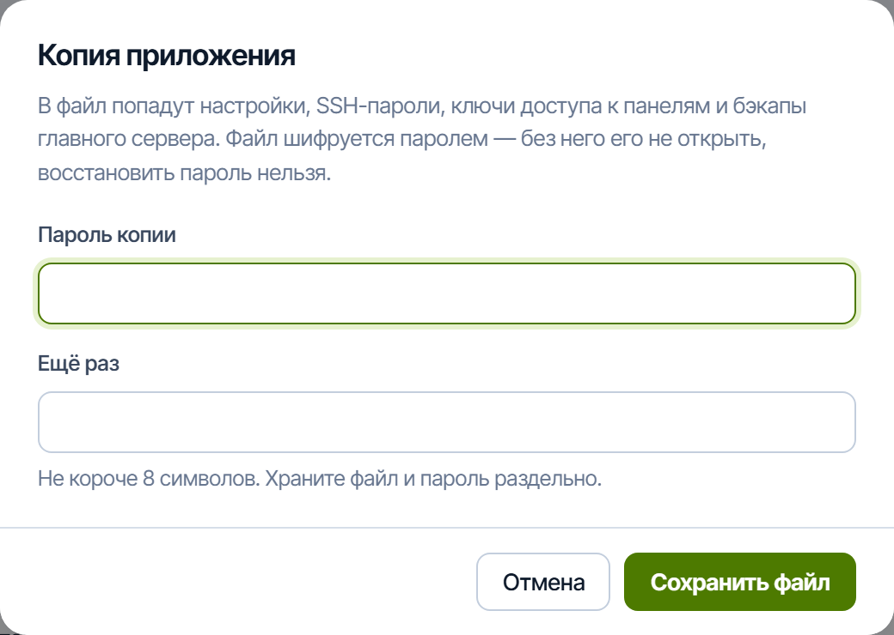

# Бэкапы и перенос



## Бэкапы главного сервера

В бэкап попадает база 3x-ui целиком — клиенты, подключения, серверы, настройки — и файлы, от которых она зависит:
сертификат домена и ключ токенов серверов.

- **Сами** — перед изменениями (серия правок за 15 минут — один бэкап, перед удалением — всегда) и при запуске
  приложения, если последнему больше 12 часов.
- **Вручную** — кнопка **«Сделать бэкап»**.
- **Хранятся** 10 последних и по одному за каждый из 30 дней. У каждого видна причина: «Перед изменением пользователя
  …», «При запуске интерфейса» и т. д.
- **Где** — в папке данных приложения на этом компьютере (кнопка «Открыть папку»). При включённой синхронизации
  на зарубежном сервере туда же уходят 3 последних бэкапа.

## Перенос главного сервера

Если главный сервер заблокировали или он умер: **«Бэкапы» → «Перенести…»**.

{ width="560" }

1. Возьмите новый VPS и введите его адрес и доступ SSH.
2. Приложение пробует взять свежий бэкап со старого сервера, а если тот недоступен — последний сохранённый.
3. На новый сервер ставится 3x-ui и восстанавливается всё: клиенты с прежними ключами, подписки, серверы, каскады.
4. **Смените A-запись домена** на новый IP. Подсказка будет в журнале.

Старый сервер не изменяется. Пользователям ничего делать не нужно — подписка и ключи прежние.

## Перенос со старой панели 3x-ui

Если до xui-fleet у вас была своя панель, её бэкап базы (`.db`) переносится одной командой — клиенты с теми же UUID,
subId, лимитами и трафиком:

```bash
xui-fleet import-backup путь/к/бэкапу.db --node ИМЯ_СЕРВЕРА --label "UK" --dry-run
```

Без `--dry-run` выполняет перенос. Повторный запуск ничего не дублирует.

## Копия приложения

Отдельно от бэкапов серверов — копия **самого приложения**: настройки, доступы к серверам и бэкапы главного сервера
одним файлом `.xfleet` под паролем. **«Бэкапы» → «Копия приложения» → «Сохранить копию…»**.

{ width="560" }

На новом компьютере: запустите приложение и на первом экране нажмите **«Восстановить из копии приложения…»**.
Подходит для любой системы — Windows, macOS, Linux.

!!! danger "Пароль не восстановить"
    Без пароля копию не открыть. Храните файл и пароль отдельно друг от друга.
