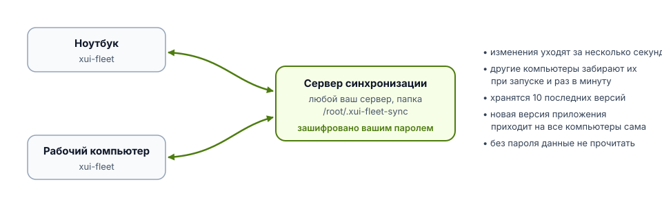
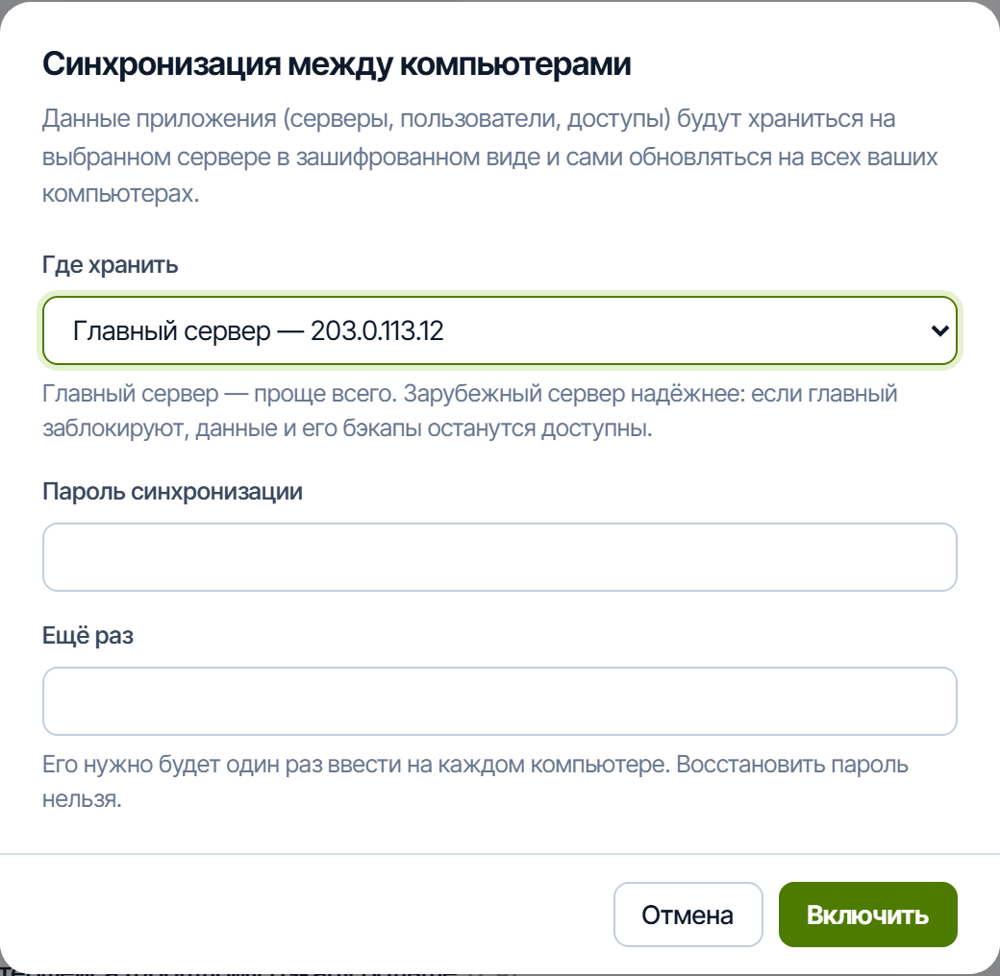

# Несколько компьютеров и профили

## Синхронизация между компьютерами

Чтобы управлять сетью с ноутбука и с рабочего компьютера, включите синхронизацию один раз:
**«Бэкапы» → «Синхронизация между компьютерами» → «Включить…»**.

{ width="560" }

- **Где хранить** — любой ваш сервер. Главный проще всего; зарубежный надёжнее: если главный заблокируют, данные
  и его бэкапы останутся доступны.
- **Пароль синхронизации** — данные шифруются им (AES-256-GCM) и лежат на сервере в `/root/.xui-fleet-sync`.
  Его нужно один раз ввести на каждом компьютере. Восстановить пароль нельзя.

Изменения уходят на сервер за несколько секунд, остальные компьютеры забирают их при запуске и раз в минуту, пока
приложение открыто. Если два компьютера поменяли что-то одновременно, изменения объединяются: добавленные на разных
компьютерах серверы и пользователи сохраняются оба; если одно и то же поле изменили на обоих, остаётся последнее.
На сервере хранятся 10 последних версий.

**Новый компьютер:** запустите приложение и на первом экране нажмите **«Подключить к синхронизации…»** — адрес
сервера, SSH-пароль и пароль синхронизации.

!!! info "Обновления приходят сами"
    Компьютер с более новой версией приложения выкладывает её на сервер синхронизации (зашифровано и подписано паролем),
    остальные ставят её и перезапускаются. Если другой компьютер уже перешёл на новую ветку версий, кнопка в шапке
    станет жёлтой «Нужно обновление»: до обновления этот компьютер копит изменения у себя, а после — объединяет их
    с сервером, ничего не теряя.

## Профили

Профиль — отдельный набор серверов со своими доступами, бэкапами и синхронизацией, как аккаунты в мессенджере.
Например, ваша сеть и сеть, которую вы держите для друзей. Переключаются кнопкой с именем профиля в шапке;
**«Новый профиль»** открывает окно первого запуска, текущий остаётся как есть.

## Выйти из профиля

**«Выйти из профиля»** стирает с этого компьютера всё, что программа о нём знает: настройки серверов, SSH-пароли,
ключи панелей, бэкапы главного сервера и пароль синхронизации. Подтверждение — название профиля.

Серверы, пользователи и их подписки **не меняются**, копия на сервере синхронизации остаётся — другие компьютеры
продолжат работать. Чтобы вернуться к этим серверам, заранее сохраните [копию приложения](backups.md#копия-приложения)
или подключитесь к синхронизации заново.

**«Стереть всё с этого компьютера»** — то же для всех профилей сразу, затем окно первого запуска.
