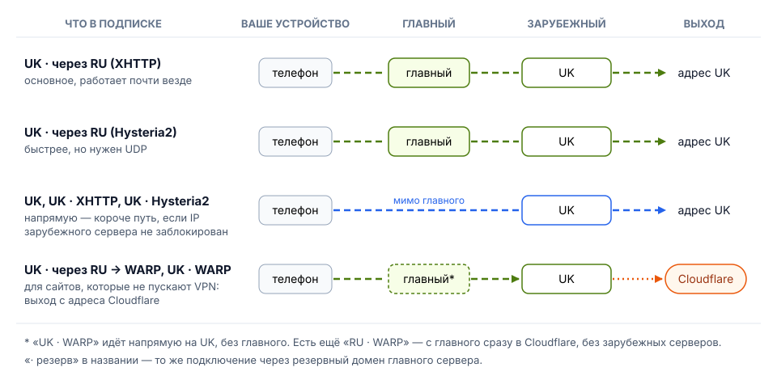

# Подключения в подписке

Для каждого зарубежного сервера приложение ведёт одинаковый набор подключений. В подписке они идут в этом порядке —
сначала самые надёжные:



| Название в подписке | Что это |
| --- | --- |
| «UK · через RU (XHTTP)» | Каскад: XHTTP + VLESS Encryption + Vision + XMUX на главном сервере, маскировка под собственный домен. **Основное.** |
| «UK · через RU (Hysteria2)» | Каскад по QUIC/UDP с сертификатом домена. |
| «UK · через RU» | Каскад VLESS Reality TCP. По умолчанию выключен: на некоторых сетях TCP к российским адресам «замерзает». |
| «UK · через RU → WARP» | Главный → зарубежный → Cloudflare WARP: выход с адреса Cloudflare. |
| «UK» | Напрямую: VLESS Reality TCP + Vision. |
| «UK · XHTTP» | Напрямую: XHTTP + VLESS Encryption + Vision + XMUX. |
| «UK · Hysteria2» | Напрямую по QUIC/UDP с обфускацией salamander; сертификат сервера закреплён в ссылке. |
| «UK · WARP» | Напрямую на сервер (Hysteria2), выход через Cloudflare WARP. |

Если у главного сервера есть резервный домен и включено «Адреса подключений через главный → основной и резервный»,
у каждого подключения «через RU» появляется второе — «· резерв».

## Что сделано против блокировок

- **XHTTP + VLESS Encryption** (ML-KEM-768 + X25519) **+ Vision + XMUX.** Внутри нет узнаваемого «TLS в TLS»,
  а XMUX раздаёт трафик по нескольким соединениям и регулярно их меняет — фильтрам не за что «заморозить» соединение.
- **Маскировка под соседний сайт.** Reality у зарубежных серверов берёт TLS-рукопожатие у настоящего сайта из той же
  подсети (TLS 1.3, h2), а не у популярного сайта вроде microsoft.com. Сайт подбирается сам, раз в сутки
  проверяется и при необходимости меняется.
- **Отпечаток браузера firefox** во всех ссылках Reality.
- **Вход на главном сервере выдаёт себя за собственный домен** (self-steal): IP-адрес и имя совпадают, на домене —
  сайт-витрина.

## Один шаблон на все серверы

Набор задаётся один раз — в `defaults.set` файла `fleet.yaml`, и любой новый сервер получает ровно его. У отдельного
сервера в `set` можно переопределить нужные поля, остальное берётся из шаблона:

```yaml
defaults:
  set:
    xhttp: true
    hysteria2: true
    cascade_xhttp: true
    cascade_hysteria2: true
    cascade_tcp: false
    warp: true
    cascade_warp: true
```

Скрыть подключение у пользователей, не выключая его на сервере, — в окне «Название и подключения» сервера
(см. [Зарубежные серверы](servers.md#название-и-какие-подключения-показывать)).

!!! info "Ключи не меняются сами"
    При смене порта или маскировки ссылки пользователей продолжают работать после обновления подписки.
    Новые ключи появляются только по кнопке «Сменить маскировку».
