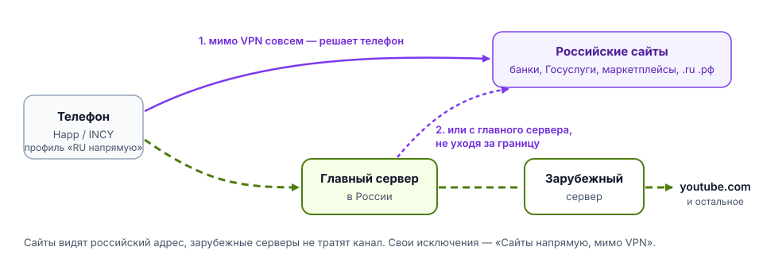
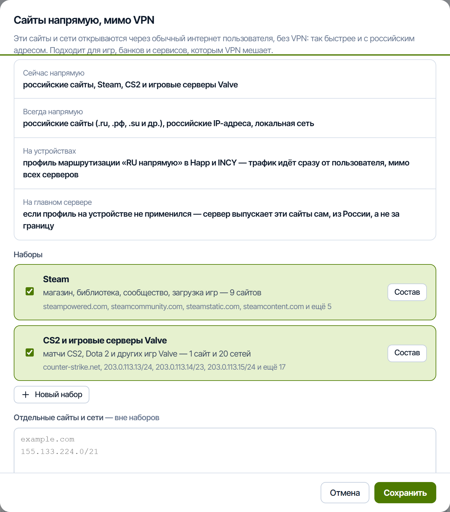

# Сайты напрямую, мимо VPN

Российские сайты (и любые другие, которые вы добавите) открываются без VPN — так быстрее, сайты видят российский адрес,
а зарубежные серверы не тратят канал.



Это работает в двух местах сразу:

1. **На устройстве.** Вместе с подпиской Happ и INCY получают профиль маршрутизации **«RU напрямую»**: российские сайты
   идут мимо VPN совсем, остальное — через VPN. Российские имена резолвит Яндекс DNS, остальные — Cloudflare
   через туннель.
2. **На главном сервере.** Если профиль на устройстве не применился, трафик подключений «через RU» к российским сайтам
   главный сервер выпускает сам, из России, а не за границу. Имена при этом не резолвятся на сервере —
   российский DNS может подменять ответы для заблокированных сайтов.

## Свой список

Меню главного сервера → **«Сайты напрямую, мимо VPN»**.

{ width="640" }

- **Сверху** — что сейчас идёт напрямую и где (на устройстве, на главном сервере).
- **Наборы** — включаются и выключаются целиком. Готовые: **Steam** и **CS2 и игровые серверы Valve** (игры
  подключаются к серверам Valve по адресу, без домена, поэтому в наборе их сети). У каждого набора кнопка
  **«Состав»** — посмотреть, изменить, переименовать, удалить или вернуть исходный состав готового.
  **«Новый набор»** — свой, например «Банк» или «Работа».
- **Отдельные сайты и сети** — по одному на строку: `example.com` или `155.133.224.0/21`.

!!! warning "Категории geosite: и geoip: здесь не принимаются"
    Если такой категории нет в базе сервера или приложения, VPN перестаёт работать целиком. В `fleet.yaml` их можно
    вписать вручную — на свой риск.

## В fleet.yaml

```yaml
routing:
  ru_direct_on_master: true   # российское — напрямую с главного сервера
  client_profile: true        # профиль «RU напрямую» для Happ и INCY в подписке
  extra_direct: [domain:example.com]
  direct_sets:
    - name: Банк
      note: личный кабинет
      enabled: true
      entries: [domain:bank.example.com]
```
