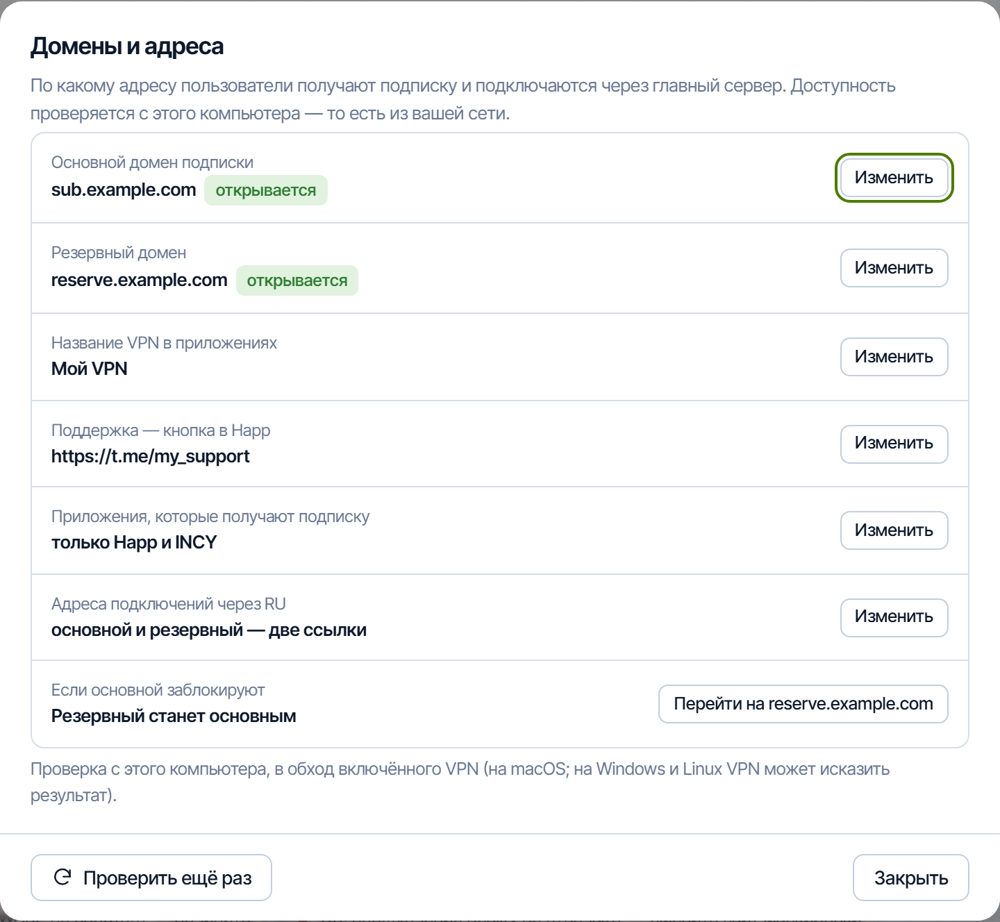
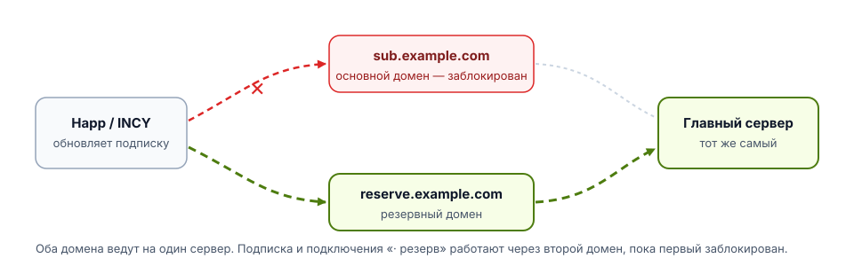

# Домены и блокировки

Меню главного сервера → **«Домены и адреса»** — всё, что касается адреса подписки и того, что видят пользователи
в приложении.

{ width="640" }

| Строка | Что это |
| --- | --- |
| **Основной домен подписки** | По нему пользователи получают подписку и подключаются через главный сервер. Зелёная метка «открывается» — проверка с этого компьютера. |
| **Резервный домен** | Второй домен на тот же сервер — на случай блокировки первого. |
| **Название VPN в приложениях** | Как подписка называется в Happ и INCY. |
| **Поддержка — кнопка в Happ** | Ссылка на ваш Telegram: кнопка «Поддержка» в Happ и продление подписки. |
| **Приложения, которые получают подписку** | Например, только Happ и INCY. Остальные приложения получат вместо подключений строку «Это приложение не поддерживается», браузер — страницу с инструкцией. |
| **Адреса подключений через главный** | Только основной домен или основной и резервный — тогда у подключений «через RU» появляется вторая ссылка «· резерв». |
| **Если основной заблокируют** | Кнопка «Перейти на …» — резервный домен станет основным. |

## Как подготовиться к блокировке домена

Заранее, пока всё работает:

1. Купите второй домен и направьте его A-запись на главный сервер.
2. «Домены и адреса» → **«Резервный домен»** — приложение выпустит для него сертификат.
3. **«Адреса подключений через главный» → «Основной и резервный»** — у каждого подключения через главный сервер
   появится вторая ссылка «· резерв». Пользователям ничего делать не нужно, достаточно обновить подписку.
4. Раздайте пользователям **резервные ссылки на подписку** (стрелка у «Ссылка» → «Резервная ссылка»).

## Если домен заблокировали

1. «Домены и адреса» → **«Перейти на …»** — резервный домен станет основным.
2. Пользователи открывают **резервную ссылку** на подписку. Подключения «· резерв» у них уже есть и работают.

Подключения напрямую к зарубежным серверам блокировка домена не затрагивает.

## Если заблокировали адрес зарубежного сервера

Признак — на [схеме маршрутов](map.md) «итого напрямую — нет связи», а «через RU» работает. Пользователи с
подключениями «через RU» ничего не заметят. Прямые подключения к этому серверу можно скрыть из подписки
(«⋯» → «Название и подключения»), а если блокировка не проходит — попросить у хостера адрес из другой подсети
или заменить сервер.

## Если заблокировали главный сервер

Перенесите его на новый VPS из бэкапа — см. [Бэкапы и перенос](backups.md#перенос-главного-сервера).
