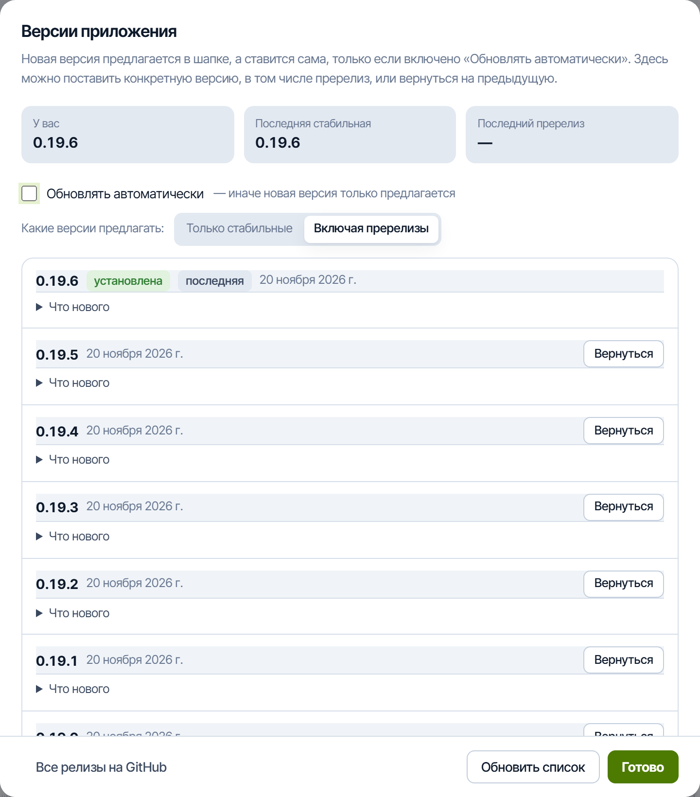

# Установка и первый запуск

## Что понадобится

- **Компьютер** с Windows, macOS или Linux — на нём работает приложение. Серверам он нужен только для настройки:
  VPN продолжает работать, когда компьютер выключен.
- **Главный сервер** — VPS с Ubuntu или Debian и доступом по SSH (root или пользователь с sudo без пароля).
  Обычно его берут в своей стране: подключения к нему не блокируют.
- **Зарубежные серверы** — один или несколько VPS за границей, тоже с SSH. Их можно добавить позже.
- **Домен** (желательно) — для адреса подписки. A-запись домена должна указывать на главный сервер.
  Второй, резервный домен пригодится на случай блокировки.

!!! tip "3x-ui ставить не нужно"
    Приложение само ставит закреплённую версию 3x-ui на каждый сервер. Если 3x-ui уже стоит, приложение
    подключится к ней и ничего не переустановит.

## Скачать и запустить

1. Скачайте `xui-fleet-<версия>.zip` со страницы
   [Releases](https://github.com/airflech/xui-fleet/releases/latest) и распакуйте в любую папку.
2. Запустите файл для своей системы:

=== "Windows"

    Двойной клик по **«Запустить xui-fleet.bat»**. Если Windows предупредит — «Подробнее» → «Выполнить в любом
    случае». На вопрос об установке Python нажмите ++enter++.

=== "macOS"

    Двойной клик по **«Запустить xui-fleet.command»**. Если macOS не даёт открыть — правый клик → «Открыть».
    Если попросит — «Установить» в окне Apple (инструменты разработчика с Python).

=== "Linux"

    `sh "Запустить xui-fleet.sh"`. Согласитесь на установку Python и введите пароль.

Первый запуск занимает 1–2 минуты, затем открывается браузер. Окно запуска можно закрыть — интерфейс работает в фоне
по постоянному адресу. Рядом с файлом запуска появится ярлык **«Открыть xui-fleet»**. После перезагрузки компьютера
снова запустите файл запуска.

!!! info "Интерфейс доступен только с этого компьютера"
    Он слушает адрес `127.0.0.1` и открывается по ссылке с личным ключом. Из сети к нему не подключиться.

## Мастер первого запуска

Приложение спрашивает четыре вещи — всё можно поменять позже.

1. **Что будет делать главный сервер.**
    - **Вход для зарубежных серверов** — пользователи подключаются к нему, а трафик уходит через зарубежные серверы
      (каскад). Выбирайте, если главный сервер стоит в вашей стране, а прямой доступ за рубеж блокируют.
    - **Сам VPN-сервер** — у вас один сервер, и он и есть VPN.
    - **И то и другое.**
2. **Сервер и доступ к нему** — IP-адрес, короткое имя и пароль SSH. Пароль сохраняется только на этом компьютере.
3. **Как раздавать подписку** — сертификат Let's Encrypt на домен (рекомендуется) или на IP-адрес; для обоих нужен
   открытый порт 80. Самоподписанный сертификат — крайний случай: приложения могут не скачать подписку.
4. **Первый пользователь** — можно пропустить.

Нажмите **«Установить и настроить»**. Через 2–5 минут сервер готов: 3x-ui, сертификат, подключения. Каждый шаг виден
в журнале.

!!! tip "Сеть уже настроена на другом компьютере?"
    На первом экране есть **«Подключить к синхронизации»** и **«Восстановить из копии»** — см.
    [Несколько компьютеров и профили](computers.md).

## Что дальше

1. [Добавьте зарубежные серверы](servers.md).
2. [Добавьте пользователей](users.md) и разошлите им приглашения.
3. Задайте [резервный домен](domains.md) — заранее, пока основной работает.
4. Включите [синхронизацию](computers.md), если пользуетесь приложением с нескольких компьютеров.

## Обновление приложения

Приложение само проверяет новые версии на GitHub при запуске и раз в 30 минут. Когда выходит новая, в шапке появляется
кнопка **«Доступна 0.x.y»**: она открывает окно «Версии» со списком изменений и кнопкой «Обновить». Там же можно
включить **«Обновлять автоматически»**, решить, предлагать ли пререлизы, и вернуться на любую прежнюю версию.

{ width="560" }

При включённой синхронизации новая версия сама приходит на остальные компьютеры.

## Где лежат данные

| | Windows | macOS | Linux |
| --- | --- | --- | --- |
| Настройки (`fleet.yaml`) | рядом с программой | рядом с программой | рядом с программой |
| Бэкапы, история, ключ интерфейса | `%APPDATA%\xui-fleet` | `~/Library/Application Support/xui-fleet` | `~/.local/share/xui-fleet` |
| Журнал | `%APPDATA%\xui-fleet\xui-fleet.log` | `~/Library/Logs/xui-fleet.log` | `~/.local/share/xui-fleet/xui-fleet.log` |

Пароли SSH и ключи панелей лежат в `.xui-fleet/state.json` рядом с программой, а не в `fleet.yaml`.
