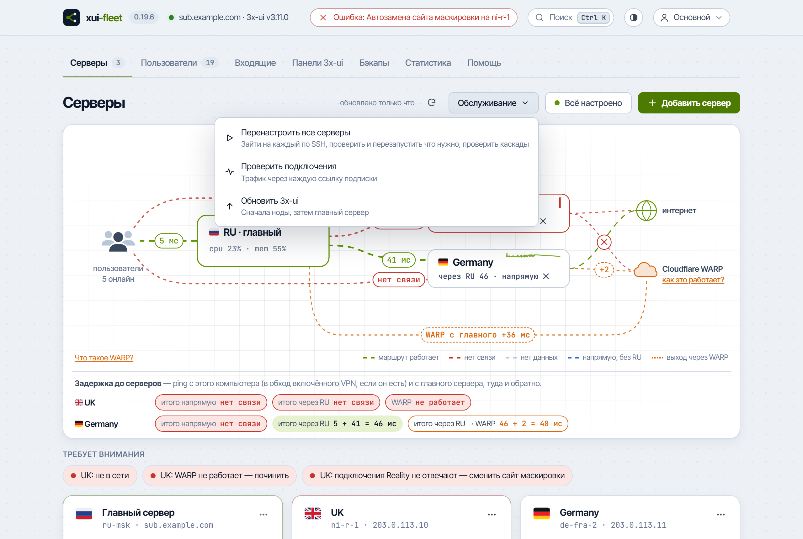
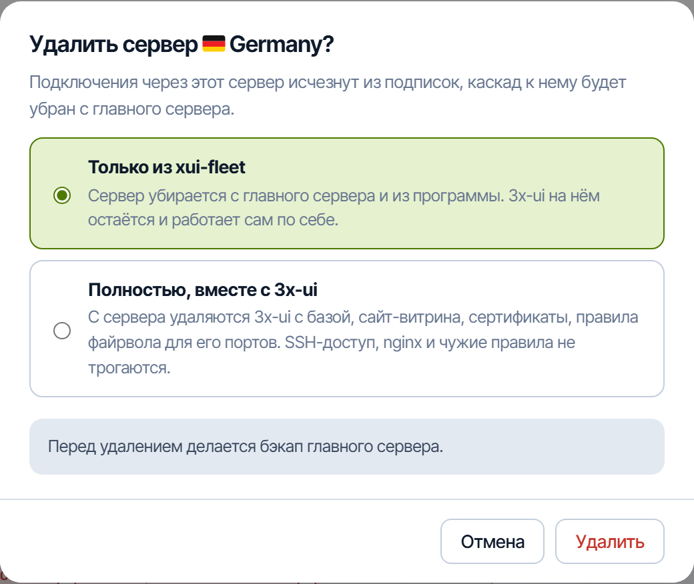
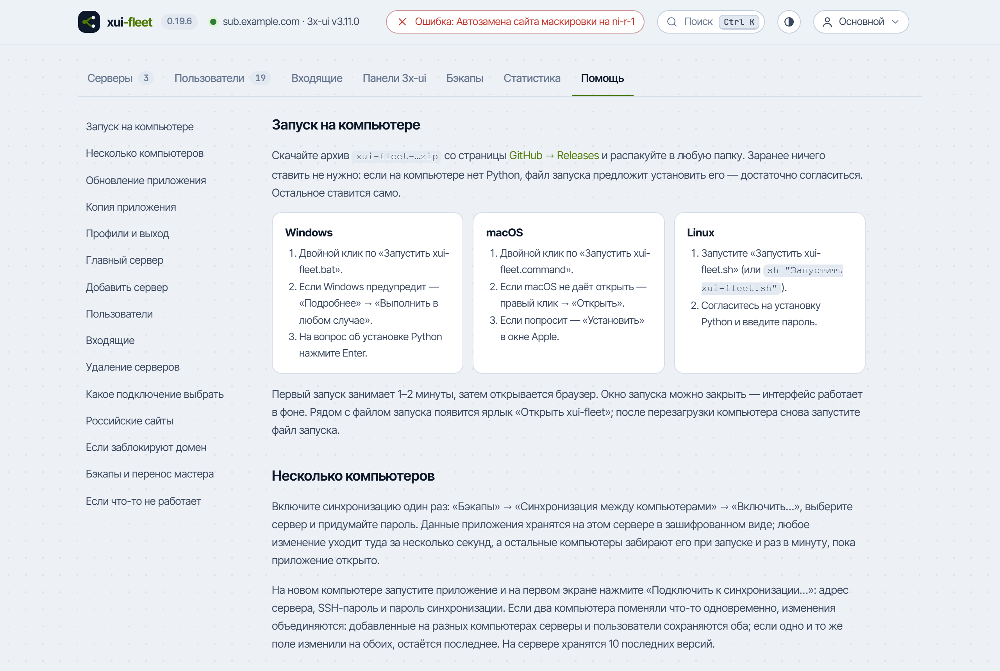

# Обслуживание и неполадки

## Кнопка «Обслуживание»

| Пункт | Что делает |
| --- | --- |
| **Перенастроить все серверы** | Зайти на каждый по SSH, проверить и перезапустить что нужно, проверить каскады. Безопасно запускать сколько угодно раз: если всё в порядке, ничего не меняется. |
| **Проверить подключения** | Прогнать трафик через каждую ссылку подписки служебного пользователя — с главного сервера. |
| **Обновить 3x-ui** | Сначала зарубежные серверы, затем главный. |

Рядом — кнопка состояния: **«Всё настроено»** или **«Исправить · N»**, если настройки на серверах разошлись с тем,
что задано в приложении. Нажатие покажет, что именно будет исправлено.

!!! note "«Проверить подключения» — из сети главного сервера"
    Проверка идёт из дата-центра, где стоит главный сервер. Домашние сети и мобильные операторы могут вести себя иначе:
    если проверка зелёная, а у пользователя не работает — дело в его сети.

## Если что-то не работает

| Что видно | Что делать |
| --- | --- |
| У пользователя не открываются сайты | Пусть обновит подписку и выберет следующее подключение той же страны. В его карточке — работает ли подписка вообще. |
| Сервер «Недоступен» / «не в сети» | Проверьте его в панели хостера (включён ли, оплачен ли). Затем «Обслуживание» → «Перенастроить все серверы». |
| «Подключения Reality не отвечают» | «⋯» у сервера → «Сменить маскировку». Приложение делает это и само, не чаще раза в час. |
| «WARP не работает» | Кнопка «починить» в «Требует внимания» — перевыбор точки входа Cloudflare. |
| Ошибка входа на сервер по SSH | «⋯» у сервера → «Адрес и доступ по SSH». Если сервер переустанавливали — его ключ изменился, приложение спросит, доверять ли новому. |
| «итого напрямую — нет связи» на схеме | Адрес сервера недоступен из вашей сети — см. [Домены и блокировки](domains.md#если-заблокировали-адрес-зарубежного-сервера). |
| Подписка не открывается по домену | См. [Домены и блокировки](domains.md#если-домен-заблокировали). |

Журнал работы приложения — кнопка **«Журнал»** в шапке; полный журнал в файле
(`%APPDATA%\xui-fleet\xui-fleet.log` на Windows, `~/Library/Logs/xui-fleet.log` на macOS,
`~/.local/share/xui-fleet/xui-fleet.log` на Linux).

## Удаление серверов

Зарубежный: «⋯» сервера → **«Удалить сервер»**. Главный: его меню → **«Удалить главный сервер»**.

{ width="560" }

- **«Только из xui-fleet»** — сервер убирается из сети, 3x-ui на нём работает дальше.
- **«Полностью, вместе с 3x-ui»** — с сервера по SSH удаляются 3x-ui с базой, сайт-витрина, сертификаты и правила
  файрвола для его портов. SSH-доступ и nginx остаются.

Перед удалением всегда делается бэкап главного сервера. Если панель не отвечает и бэкап сделать нельзя, приложение
спросит, удалять ли без него. После удаления главного профиль открывается с окна первого запуска, бэкап остаётся.

## Помощь в приложении

Вкладка **«Помощь»** — краткая версия этой документации прямо в приложении, работает без интернета.

