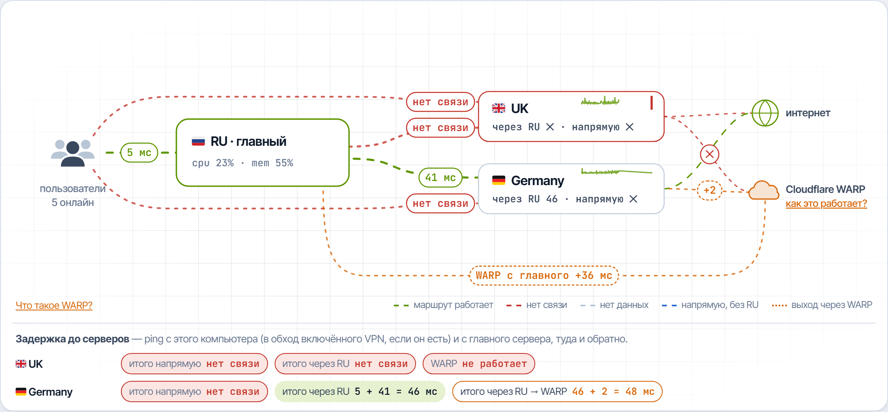
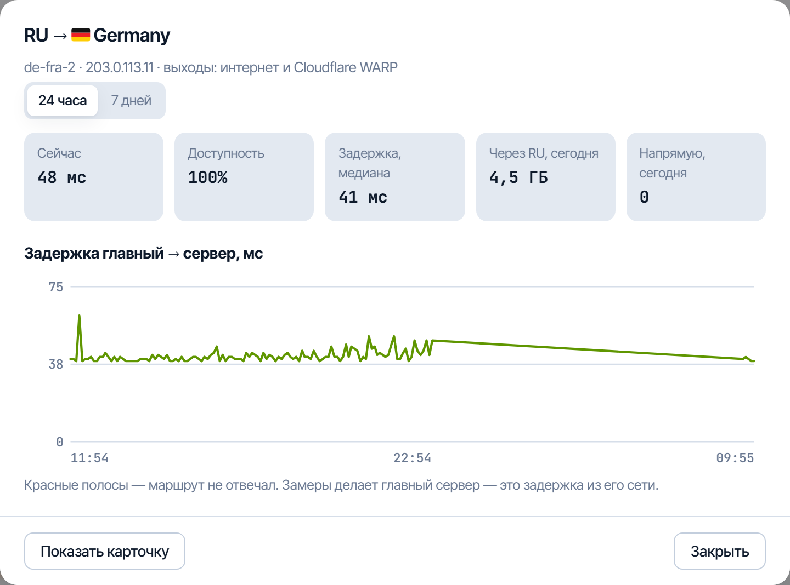
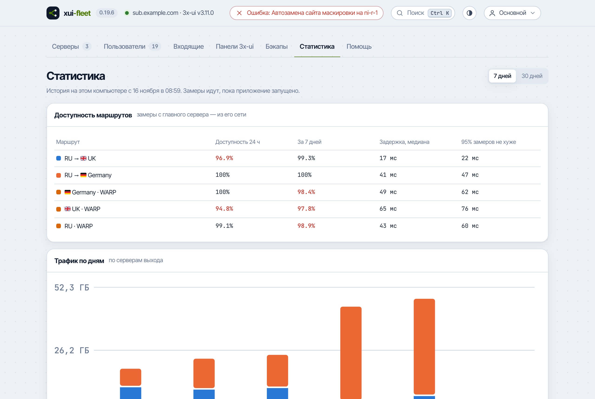

# Схема маршрутов и задержки

Вверху вкладки «Серверы» — живая схема сети: как трафик пользователей идёт от них до интернета, и сколько это стоит
по задержке.

## Как читать схему

| Линия | Что значит |
| --- | --- |
| зелёная пунктирная, «бегущая» | маршрут работает, по нему идёт трафик |
| красная | нет связи |
| серая | данных пока нет |
| синяя | напрямую к зарубежному серверу, без главного |
| оранжевая точками | выход в интернет через Cloudflare WARP |

- **Цифры на линиях** — задержка участка в миллисекундах (ping туда и обратно).
- **«пользователи · N онлайн»** — сколько людей подключено прямо сейчас.
- **Справа** — выходы: «интернет» (сайты видят адрес зарубежного сервера) и «Cloudflare WARP»
  (сайты видят адрес Cloudflare). **+N мс** у WARP — сколько WARP добавляет к задержке.
- **«WARP с главного»** внизу — если у главного сервера включена роль WARP.
- Маленький график в карточке сервера на схеме — история задержки за последние сутки.

Схема строится по настоящим подключениям в панели: скрытые из подписки и выключенные пути на ней не рисуются,
а если через главный сервер не идёт ничего, он пропадает со схемы.

## Таблица задержек

Под схемой — итоговая задержка для каждого сервера разными путями:

- **итого напрямую** — этот компьютер → зарубежный сервер;
- **итого через RU** — этот компьютер → главный + главный → зарубежный;
- **итого через RU → WARP** — то же плюс то, что добавляет WARP;
- **RU добавляет** — насколько путь через главный длиннее прямого.

!!! note "Задержки — из вашей сети"
    Первый участок меряется с компьютера, на котором открыто приложение (в обход включённого на нём VPN, если он есть).
    У ваших пользователей в других сетях цифры будут другими. Участок «главный → зарубежный» меряет главный сервер.

!!! example "«итого напрямую — нет связи», а через RU всё работает"
    Значит, из вашей сети адрес зарубежного сервера недоступен, а с главного сервера — доступен. Так выглядит
    блокировка адреса (или всей подсети хостера) у вашего провайдера. Пользователи через главный сервер не пострадают;
    прямые подключения к этому серверу можно скрыть из подписки, пока блокировка действует.

## История маршрута

Клик по серверу на схеме открывает его историю: задержка главный → сервер за 24 часа или 7 дней, доступность,
трафик через главный и напрямую. Красные полосы — периоды, когда маршрут не отвечал.

{ width="640" }

## «Требует внимания»

Под схемой приложение выводит то, что стоит починить, — с кнопкой, которая это делает: сервер не в сети, WARP
не работает, подключения Reality не отвечают (сменить маскировку), подписка не открывается по домену.

!!! info "Кое-что приложение чинит само"
    Если подключения Reality сервера не отвечают две проверки подряд, приложение само меняет сайт маскировки
    (не чаще раза в час). Если WARP перестал пропускать трафик — само перевыбирает точку входа Cloudflare
    (не чаще раза в 3 часа). Обе операции видны в журнале.

## Статистика

Вкладка **«Статистика»** — история с этого компьютера за 7 или 30 дней: доступность каждого маршрута, медиана
и 95-й процентиль задержки, трафик по дням по серверам выхода. Замеры идут, пока приложение запущено.

