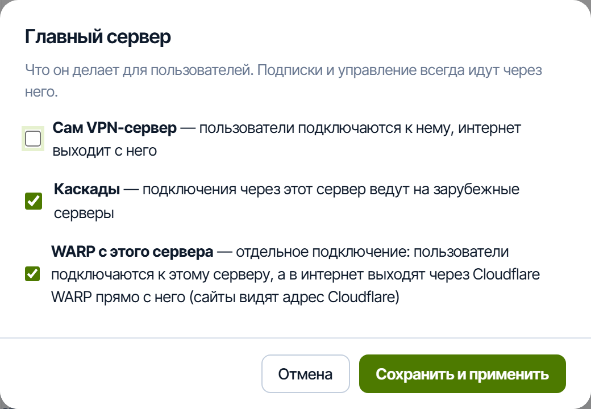

# Главный сервер

Через главный сервер **всегда** идут подписки и управление: на нём главная панель 3x-ui, к которой подключены все
остальные серверы. Кроме этого, у него есть роли — их можно включать вместе.

{ width="560" }

Где поменять: карточка «Главный сервер» → **«⋯» → «Роль и подключения»**.

| Роль | Когда включать |
| --- | --- |
| **Каскады** | Главный сервер — промежуточный, обычно в вашей стране. Пользователи подключаются к нему, а трафик уходит через зарубежные серверы. Работает даже там, где зарубежные адреса закрыты («белые списки»). |
| **Сам VPN-сервер** | У вас один сервер (обычно за рубежом), и он — ваш VPN. Пользователи получают его собственный набор подключений. |
| **WARP с этого сервера** | Отдельное подключение «RU · WARP»: пользователи подключаются к главному серверу, а в интернет выходят через Cloudflare WARP прямо с него. Сайты видят адрес Cloudflare. Подробнее — [WARP](warp.md). |

!!! note "«RU» — просто название"
    В подписке подключения через главный называются «через RU», потому что так он назван по умолчанию.
    Название меняется там же — в «Роль и подключения».

## Меню главного сервера

| Пункт | Что делает |
| --- | --- |
| **Роль и подключения** | Роли выше и название в подписке. |
| **Домены и адреса** | Домен подписки, резервный домен, название VPN, поддержка, приложения — см. [Домены и блокировки](domains.md). |
| **Сайты напрямую, мимо VPN** | Что открывается без VPN — см. [Сайты напрямую](direct.md). |
| **Адрес и доступ по SSH** | Сменить адрес, пользователя, порт, пароль или ключ SSH. |
| **Сменить маскировку** | Новые ключи подключений главного сервера — если их начали блокировать. Пользователям нужно будет обновить подписку. |
| **Удалить главный сервер** | Удаляет всю сеть этого профиля — см. [Обслуживание](maintenance.md#удаление-серверов). |

## Сайт-витрина

Чтобы домен и IP-адрес не вызывали вопросов, на главном сервере по адресу `https://ваш-домен/` открывается обычный
сайт небольшой компании (бренд вымышленный, тема подбирается по имени домена). Тот же сайт видит любой, кто
«прощупывает» подключения. Порт 443 главного сервера занят витриной и подключениям не выдаётся.

## Если главный сервер заблокируют

Сеть переносится на новый VPS из бэкапа целиком, со всеми ключами и подписками — см.
[Бэкапы и перенос](backups.md#перенос-главного-сервера).
