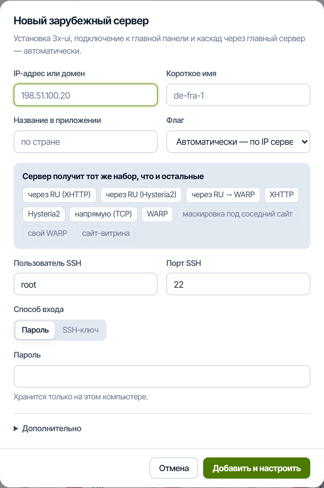
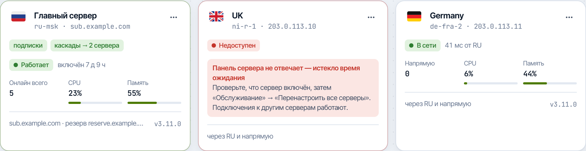
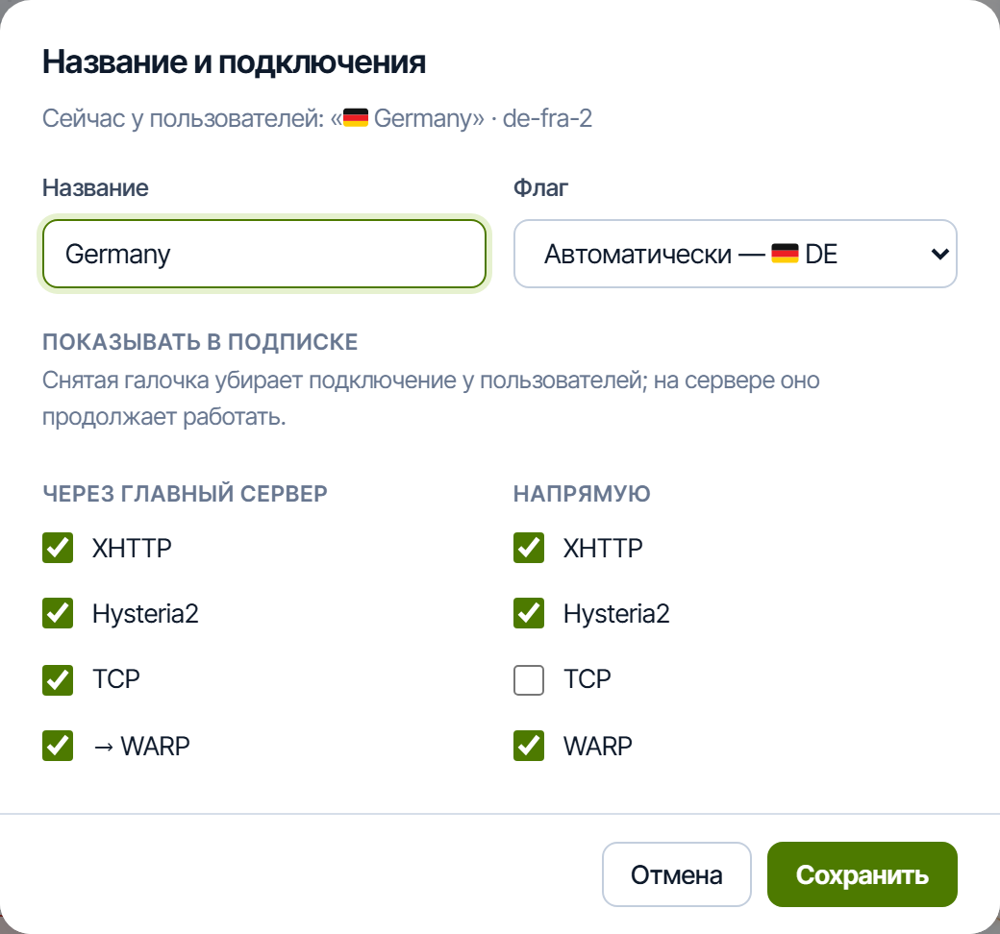
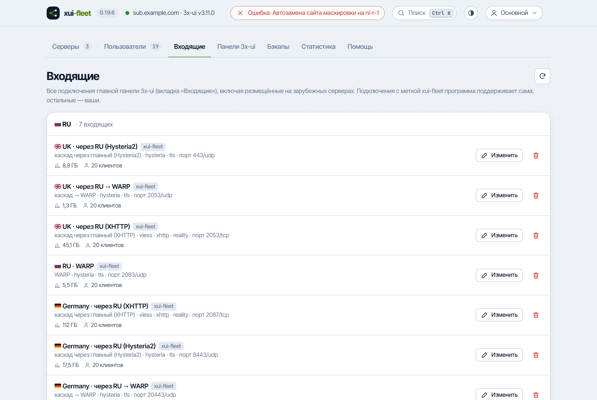
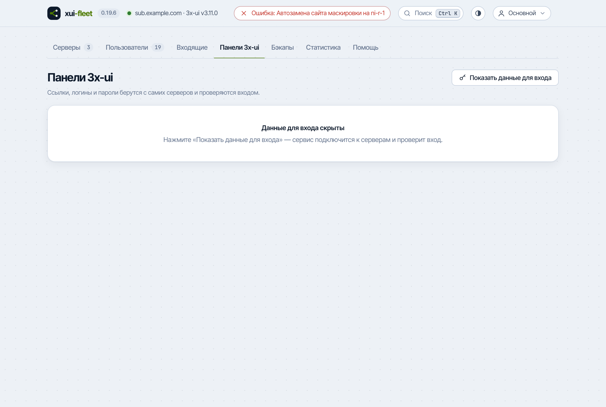

# Зарубежные серверы

## Добавить сервер

**«Серверы» → «Добавить сервер»**: IP-адрес, короткое имя (латиницей, например `de-fra-1`) и пароль SSH.
Название в приложениях и флаг подставятся по стране сервера, если оставить их пустыми.

{ width="560" }

Нажмите **«Добавить и настроить»** — дальше приложение всё делает само, ход работы виден в журнале:

1. ставит 3x-ui и подключает сервер к главной панели;
2. создаёт **тот же набор подключений, что у остальных серверов** — окно заранее показывает, какой именно;
3. подбирает **маскировку под соседний сайт** — настоящий сайт из той же подсети, под чьё TLS-рукопожатие
   маскируются подключения Reality;
4. регистрирует серверу **собственный WARP**;
5. ставит **сайт-витрину** на `http://IP/`;
6. добавляет новые подключения **всем существующим пользователям** — им достаточно обновить подписку.

!!! tip "SSH-ключ вместо пароля"
    В окне можно выбрать «SSH-ключ». Пароль или ключ хранится только на этом компьютере (и, если включена
    синхронизация, — зашифрованным на сервере синхронизации).

## Карточки серверов

Под схемой маршрутов — карточка каждого сервера: состояние, нагрузка, подключения.

Меню **«⋯»** на карточке:

| Пункт | Что делает |
| --- | --- |
| **Название и подключения** | Название и флаг в подписке; какие подключения показывать пользователям. |
| **Адрес и доступ по SSH** | Если сменили пароль, порт или переустановили сервер. |
| **Перенастроить этот сервер** | Зайти по SSH, проверить и вернуть его настройки и каскад. Другие серверы не трогаются. |
| **Сменить маскировку** | Подобрать другой соседний сайт для Reality — если подключения к серверу начали блокировать. |
| **Удалить сервер** | См. [Обслуживание](maintenance.md#удаление-серверов). |

## Название и какие подключения показывать

{ width="560" }

Снятая галочка убирает подключение **только из подписки**: на сервере оно продолжает работать. Это удобно, если
какой-то способ перестал работать у ваших пользователей — например, адрес сервера заблокирован у провайдеров,
и прямые подключения к нему бесполезны, а «через главный» работают.

!!! warning "Прямое подключение скрывается, но не удаляется"
    Через него идут каскады с главного сервера. Поэтому «удалить» его нельзя — только скрыть из подписки.

## Подключения сервера

Каждый зарубежный сервер получает одинаковый набор — подробно в разделе
[Подключения в подписке](connections.md). Свои порты и вкл/выкл можно менять во вкладке **«Входящие»**:

Подключения с меткой **xui-fleet** приложение поддерживает само: порт и вкл/выкл меняются здесь (каскад и файрвол
подстроятся), а удаление выключает этот тип подключения у сервера — приложение его больше не создаёт.
Свои входящие, созданные руками в 3x-ui, можно переименовать, выключить и удалить.

## Панели 3x-ui

Вкладка **«Панели 3x-ui»** — ссылки, логины и пароли панелей всех серверов. Данные скрыты, пока не нажать
«Показать данные для входа».

