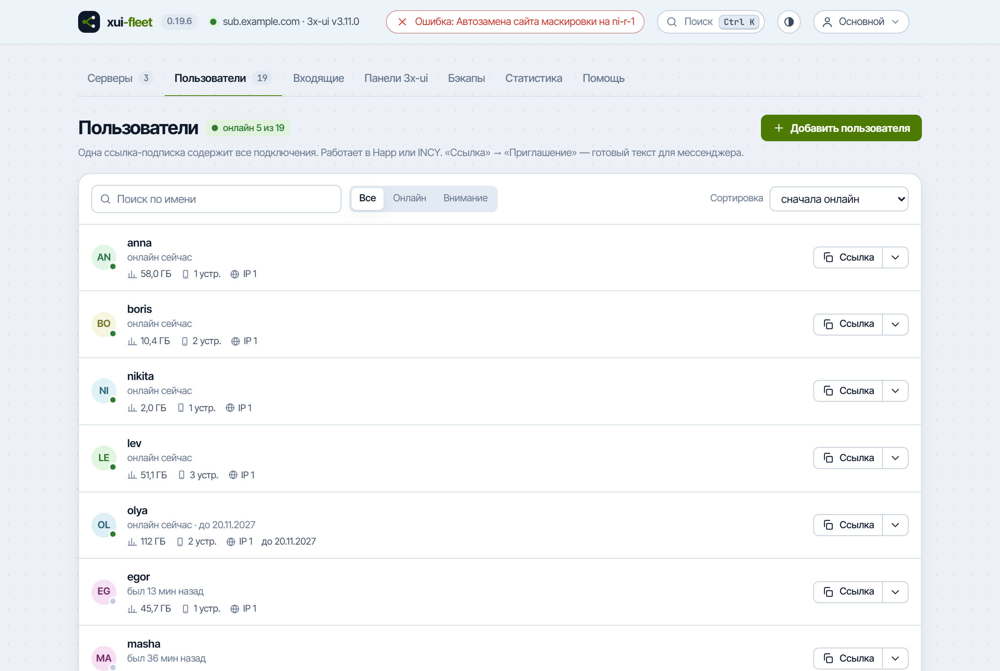
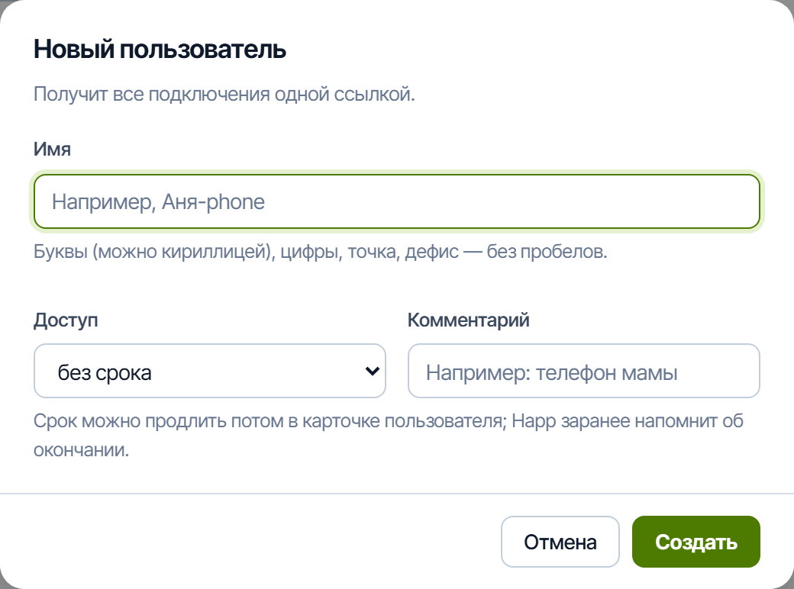
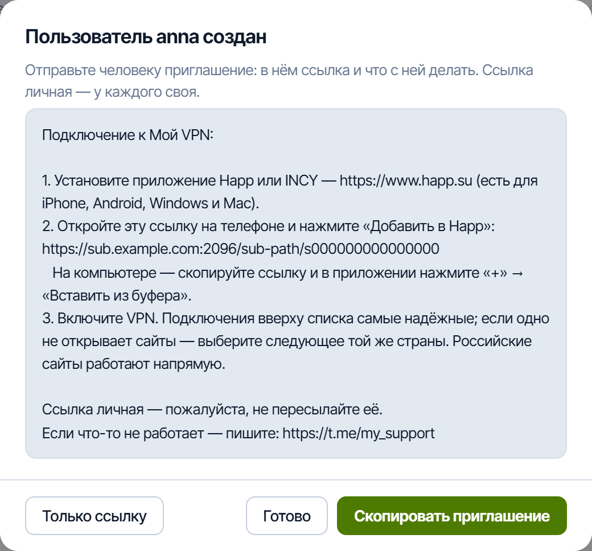
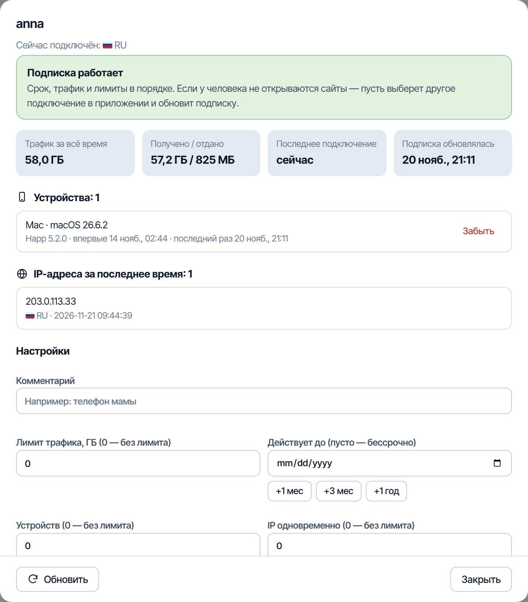

# Пользователи

У каждого пользователя — трафик за всё время, число устройств и IP-адресов, а если он онлайн — серверы, через которые
подключён. Фильтры «Онлайн» и «Внимание» (истекает срок, превышен лимит) и сортировка — над списком.

## Добавить пользователя

**«Пользователи» → «Добавить пользователя»**: имя (буквы, можно кириллицей, цифры, точка, дефис — без пробелов),
срок доступа и комментарий.

{ width="560" }

Пользователь сразу получает **все подключения всех серверов одной ссылкой**. Новые серверы тоже появятся у него сами.

## Приглашение

После создания открывается **приглашение** — готовый текст для мессенджера: ссылка, какое приложение поставить и что
нажать. Его можно скопировать и позже: стрелка у кнопки «Ссылка» → **«Приглашение»**.

{ width="560" }

Если человек откроет ссылку в браузере, он увидит страницу с теми же тремя шагами и кнопкой «Добавить в Happ» —
см. [инструкцию для пользователей](../users/index.md).

!!! tip "Поддержка"
    Задайте «Домены и адреса» → **«Поддержка»** (ссылка на Telegram). В Happ появится кнопка «Поддержка», а когда
    подписка закончится, кнопка продления тоже поведёт туда. Ссылка попадёт и в приглашение.

## Карточка пользователя

Клик по пользователю открывает карточку.

{ width="560" }

- **Итог сверху** — работает ли подписка, а если нет — почему: закончился срок, трафик или пользователь выключен.
- **Устройства** — модель, система, приложение, когда впервые и в последний раз. Видны, если приложение сообщает о себе
  при обновлении подписки (Happ, v2RayTun, INCY). **«Забыть»** освобождает место под новое устройство.
- **IP-адреса** — с какого адреса и через какой сервер подключался.
- **Настройки** — комментарий, лимит трафика, срок (**+1 мес**, **+3 мес**, **+1 год**), лимиты устройств и IP,
  включён ли.
- Внизу — **«Сбросить трафик»** и **«Удалить пользователя»** (перед удалением делается бэкап главного сервера).

Красным отмечено то, что превышает лимит.

## Лимиты: устройства и IP

| Лимит | Что делает | Чего не может |
| --- | --- | --- |
| **Устройств** | Не даёт новой копии подписки заработать на лишнем устройстве. | Не остановит конфиг, уже скопированный в приложение. |
| **IP одновременно** | Лишние одновременные адреса 3x-ui отключает на время. | — |

Чтобы человек не раздавал подписку, обычно ставят оба. Трафик 3x-ui считает на пользователя целиком, по отдельным
подключениям не делит.

!!! note "Где хранятся лимиты"
    В главной панели 3x-ui. `fleet.yaml` задаёт их только новым пользователям; изменения в панели приложение
    не перезаписывает.

## Резервная ссылка

Если у главного сервера есть резервный домен, у каждого пользователя есть вторая ссылка — стрелка у «Ссылка» →
**«Резервная ссылка»**. Раздайте её заранее: она пригодится, если основной домен заблокируют.
См. [Домены и блокировки](domains.md).
