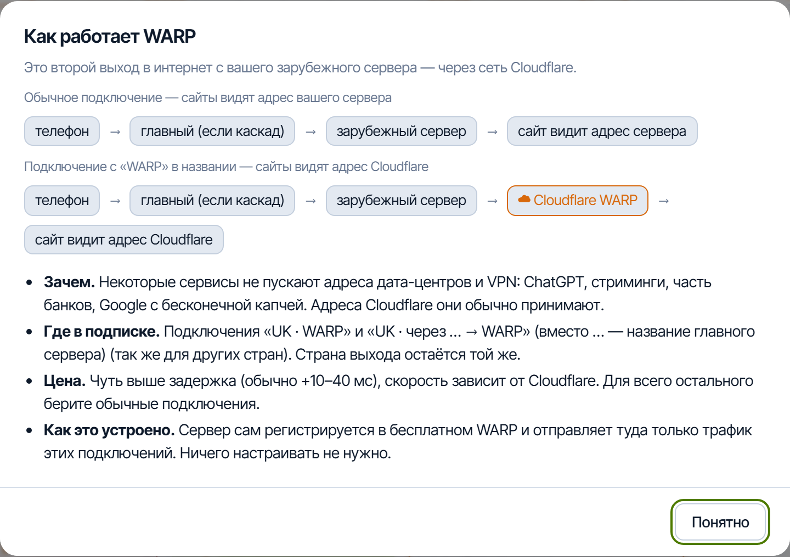

# WARP

[Cloudflare WARP](https://one.one.one.one/) — бесплатная сеть Cloudflare. Подключения со словом **WARP** выходят
в интернет не с адреса вашего сервера, а с адреса Cloudflare. Это нужно для сайтов, которые не пускают адреса
хостингов и VPN: YouTube с проверкой «вы не бот», некоторые стриминги, сайты с проверкой страны.

{ width="560" }

## Как устроено

- Каждый сервер получает **собственную регистрацию WARP** — бан или сбой одной не задевает другие.
- Точка входа в Cloudflare выбирается замером раз в сутки: самая быстрая из тех, **что выводят трафик за границу**.
  С сервера в Москве самая быстрая точка обычно ведёт в московский узел Cloudflare — сайты увидели бы российский адрес,
  поэтому такие точки отбрасываются.
- Каждые 5 минут приложение проверяет, что WARP действительно пропускает трафик. Если перестал — само перевыбирает
  точку входа (не чаще раза в 3 часа).
- На схеме маршрутов видно, сколько WARP добавляет к задержке («+N мс»).

## Какие бывают

| Подключение | Путь |
| --- | --- |
| «UK · WARP» | пользователь → зарубежный сервер → Cloudflare |
| «UK · через RU → WARP» | пользователь → главный → зарубежный → Cloudflare |
| «RU · WARP» | пользователь → главный → Cloudflare. Включается ролью «WARP с этого сервера» у главного сервера. |

## Ограничения

!!! warning "Правила Cloudflare"
    Бесплатный WARP не ограничен по трафику, но лицензия приложения WARP — личная, и Cloudflare может ограничить или
    отключить регистрацию при жалобах или чрезмерной нагрузке. Самый частый повод для жалоб — торренты. WARP —
    подключение для сайтов, которым он нужен, а не для всего трафика. Если регистрацию отключат, пострадает только
    WARP этого сервера: остальные подключения продолжат работать.
