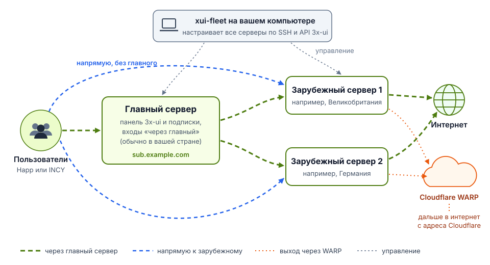
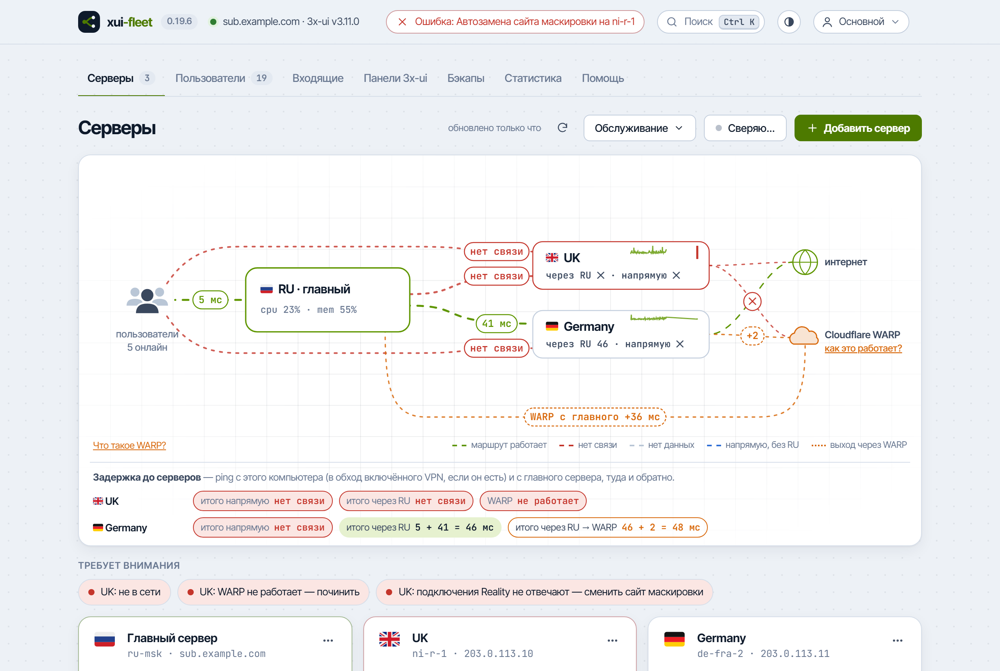

# xui-fleet

**xui-fleet** — приложение на вашем компьютере, которое собирает из нескольких VPS собственный VPN-сервис:
главный сервер, зарубежные серверы и **одна ссылка-подписка** для каждого пользователя со всеми подключениями сразу.
Под капотом — обычная панель [3x-ui](https://github.com/MHSanaei/3x-ui). Её можно открыть и пользоваться ею руками:
приложение ничего в ней не ломает, а только добавляет свои подключения.

## Кому какой раздел

-   :material-cellphone-link: **Пользователям VPN**

    ---

    Вам прислали ссылку. Как поставить приложение, добавить подписку и что делать, если что-то не открывается.

    [:octicons-arrow-right-24: Подключение](users/index.md)

-   :material-server-network: **Администратору**

    ---

    Вы держите серверы. Установка приложения, серверы и пользователи, бэкапы, блокировки.

    [:octicons-arrow-right-24: Установка и первый запуск](admin/install.md)

## Что умеет

- **Ввести SSH-доступ один раз — остальное само.** Приложение ставит 3x-ui, выпускает сертификаты, создаёт
  подключения, связывает серверы между собой и регистрирует каждому собственный Cloudflare WARP.
- **Одна подписка.** Пользователь добавляет одну ссылку в Happ или INCY. Новые серверы появляются у него сами,
  достаточно обновить подписку.
- **Работа при блокировках.** Подключения «через главный сервер» идут к серверу в вашей стране, а уже он — за границу.
  Так VPN работает даже там, где зарубежные адреса закрыты. Плюс маскировка под соседний сайт, резервный домен и
  перенос главного сервера на новый VPS из бэкапа.
- **Российские сайты мимо VPN.** Банки, Госуслуги и маркетплейсы открываются напрямую.
- **Всё видно.** Схема маршрутов с задержками, кто онлайн и через какой сервер, устройства и трафик пользователей,
  история доступности.
- **Бэкапы и несколько компьютеров.** Бэкап главной панели перед каждым изменением, синхронизация между вашими
  компьютерами, копия приложения одним файлом.

## Словарь

| Слово | Что значит |
| --- | --- |
| **Главный сервер** | VPS с главной панелью 3x-ui. Через него идут подписки и управление; обычно стоит в вашей стране и принимает подключения «через главный». |
| **Зарубежный сервер** (нода) | VPS за границей. С него трафик выходит в интернет. |
| **Подписка** | Личная ссылка пользователя. Приложение (Happ, INCY) скачивает по ней список подключений и само его обновляет. |
| **Подключение** (входящее, inbound) | Один способ попасть на сервер: протокол, порт, ключи. В подписке у каждого своё название, например «UK · через RU (XHTTP)». |
| **Каскад** | Подключение через главный сервер: пользователь → главный → зарубежный → интернет. |
| **WARP** | Бесплатная сеть Cloudflare. Выход «через WARP» показывает сайтам адрес Cloudflare вместо адреса вашего сервера. |
| **Профиль** | Отдельный набор серверов в приложении — как аккаунты в мессенджере. |

!!! info "Документация в PDF"
    Та же документация одним файлом — `xui-fleet-docs-<версия>.pdf` на странице
    [последнего релиза](https://github.com/airflech/xui-fleet/releases/latest).
