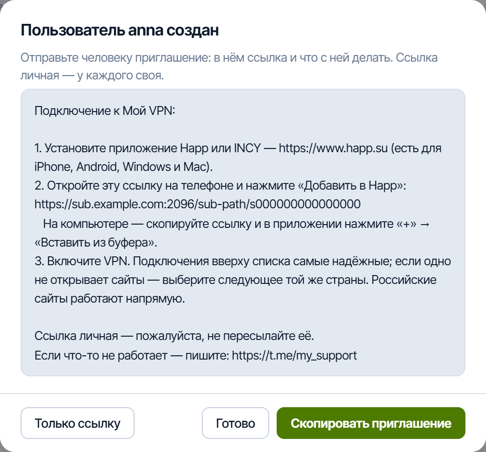
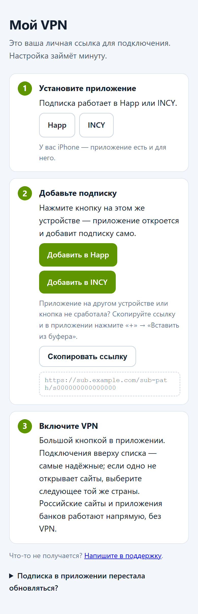
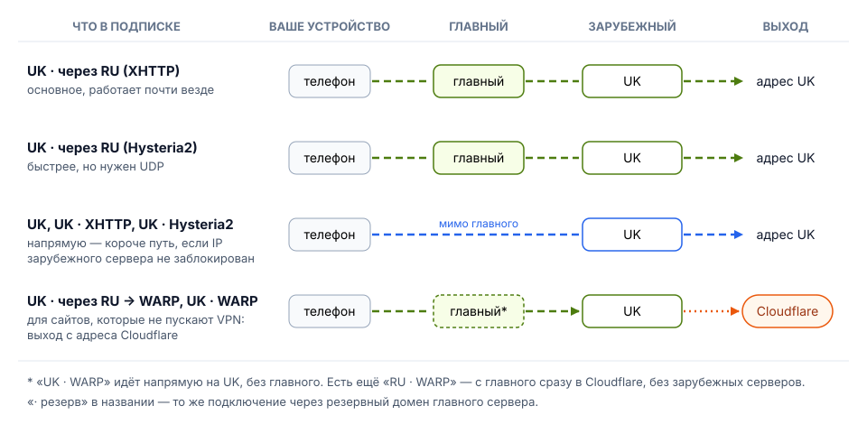
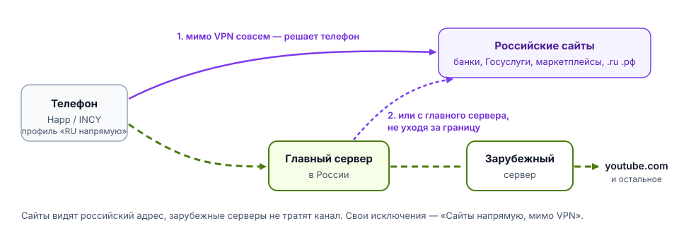

# Подключение к VPN

Эта страница — для тех, кому прислали ссылку на VPN. Настройка занимает пару минут.

!!! tip "Коротко"
    1. Поставьте приложение **Happ** (или **INCY**).
    2. Откройте свою ссылку на телефоне и нажмите **«Добавить в Happ»**.
    3. Включите VPN большой кнопкой.

## 1. Установите приложение

Подписка работает в приложениях **Happ** и **INCY**. В других приложениях вместо подключений появится строка
«Это приложение не поддерживается».

| Приложение | Где взять |
| --- | --- |
| Happ — iPhone, iPad, Android, Windows, Mac | [happ.su](https://www.happ.su), в App Store и Google Play — «Happ» |
| INCY | [incy.cc](https://incy.cc) |

## 2. Добавьте подписку

Вам прислали сообщение примерно такого вида — в нём ваша личная ссылка:

{ width="560" }

**На телефоне.** Откройте ссылку. Появится страница с тремя шагами — нажмите **«Добавить в Happ»**
(или «Добавить в INCY»): приложение откроется и добавит подписку само.

<figure markdown>
{ width="300" }
<figcaption>Так выглядит ваша ссылка, если открыть её в браузере</figcaption>
</figure>

**На компьютере** (или если кнопка не сработала). Скопируйте ссылку целиком, откройте приложение и нажмите
**«+»** → **«Вставить из буфера»**.

!!! warning "Ссылка личная"
    Не пересылайте её. Администратор видит, сколько устройств пользуется подпиской, и может ограничить их число —
    тогда лишнее устройство просто не подключится.

## 3. Включите VPN

Нажмите большую кнопку в приложении. При первом включении телефон спросит разрешение на VPN — разрешите.

## Какое подключение выбрать

Подписка сгруппирована по странам, внутри — сначала самые надёжные подключения. **Обычно хватает первого в списке.**

| В названии | Когда выбирать |
| --- | --- |
| **через RU (XHTTP)** | Основное. Работает почти везде, в том числе в мобильных сетях с «белыми списками». |
| **через RU (Hysteria2)** | Быстрее, но нужен UDP. Если не подключается — ваша сеть режет UDP, берите XHTTP. |
| **XHTTP**, **Hysteria2** или просто название страны | Напрямую к зарубежному серверу, без промежуточного. Быстрее, если адрес сервера не заблокирован у вашего провайдера. |
| **WARP** | Выход в интернет с адреса Cloudflare. Для сайтов, которые не пускают VPN или просят доказать, что вы не робот. |
| **· резерв** | То же подключение через запасной адрес. Пригодится, если основной заблокируют. |

## Российские сайты

Банки, Госуслуги, маркетплейсы и другие российские сайты открываются **напрямую, мимо VPN** — выключать VPN ради них
не нужно. Это делает профиль «RU напрямую», который приходит вместе с подпиской.

## Обновляйте подписку

Новые серверы и исправления приходят через подписку. Приложение обновляет её само, но если что-то перестало
работать — обновите вручную кнопкой обновления у подписки в приложении.

Не получается? — [Если что-то не работает](problems.md).
